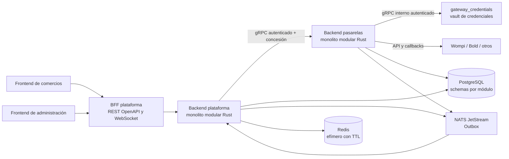

<div align="center">

# Ruta-pay

**Orquestador de pagos multi-pasarela en Rust.**
Una sola API para Wompi, Bold y proveedores habilitados, con webhooks verificados, idempotencia y actualizaciones en tiempo real.


</div>

> **Estado del repositorio:** planificación y scaffolds. Las funcionalidades y contratos de esta guía describen el diseño objetivo; no se consideran disponibles hasta que estén implementados, publicados en OpenAPI y validados mediante pruebas de aceptación.

## ¿Qué es Payvia?

Payvia es una plataforma SaaS multi-tenant que ofrece a cada comercio una API unificada para crear intenciones de pago, conectar sus cuentas de pasarela, recibir estados normalizados y conocer el resultado sin consultar manualmente cada proveedor. Payvia administra también los tenants, planes, precios, límites, suscripciones y facturación que cobra por el uso de la plataforma.

El producto se compone de dos aplicaciones backend independientes —plataforma y pasarelas— y dos frontends independientes —comercios y administración—. Cada backend es internamente un monolito modular Rust. Plataforma es la autoridad de negocio y autorización. Pasarelas implementa los protocolos técnicos de Wompi, Bold y proveedores que se incorporen.

## Características

- API de pago común con `payment_intents`, montos enteros en unidades menores, idempotencia y estados de negocio controlados.
- Módulo independiente por proveedor, con credenciales cifradas, capacidades verificadas y webhooks entrantes validados según el protocolo oficial de cada pasarela.
- Links de pago y representación QR para comercios.
- API Keys separadas por entorno `test`/`live`, scopes, revocación y visualización del secreto una sola vez.
- Webhooks salientes firmados, persistentes, con historial de intentos y reintentos programados.
- Actualización de transacciones en tiempo real por WebSocket autenticado y recuperación mediante REST.
- Gestión de tenants, planes, límites, suscripciones, facturación y auditoría desde la plataforma.
- Separación de sesiones, permisos y experiencias entre usuarios de comercio y administradores de Payvia.

Wompi y Bold son las primeras integraciones planeadas. Mercado Pago, Stripe, PayPal u otros proveedores solo se habilitan después de verificar su documentación, capacidades por país/cuenta y sandbox oficial.

## Arquitectura



La plataforma posee tenants, autorización, payment intents, transacciones, cobros de Payvia, BFF y realtime. Pasarelas posee únicamente adapters y protocolos de proveedores. Los módulos se comunican por gRPC síncrono o eventos durables JetStream/Outbox; no comparten código interno ni acceden a datos ajenos. Hay una base física PostgreSQL compartida, con schema, tablas y migraciones bajo ownership exclusivo de cada módulo. Redis se usa solo para estado efímero con TTL, nunca como autoridad financiera.

Los navegadores consumen exclusivamente el BFF de plataforma mediante REST/OpenAPI y WebSocket autenticado. Nunca llaman al backend de pasarelas, a un proveedor, a gRPC, PostgreSQL, Redis o NATS.

## Comunicación segura entre backends

Plataforma y pasarelas se autentican como servicios con identidad criptográfica sobre gRPC cifrado con TLS/mTLS. La identidad no depende de IP o de un header declarativo. Certificados y trust roots se rotan con periodo de solapamiento. Además de autenticar el servicio, cada RPC valida caller, método, scope y una concesión breve firmada, ligada al tenant, proveedor/cuenta, ambiente, importe/operación, audiencia, `jti` y expiración.

Ambos lados validan versión, tipos, longitudes, tamaño, rango, deadline e idempotencia; aplican rate limit, timeouts, concurrencia limitada y reintentos acotados con backoff+jitter solo cuando el error y la operación permiten retry seguro. Un timeout de resultado financiero incierto exige reconciliación antes de repetir. Logs correlacionados capturan autorización, dependencia, fallo y cierre con `correlation_id`/`trace_id`, sin secretos, credenciales, certificados, tokens o payload sensible.

gRPC es para consultas y comandos que requieren una respuesta inmediata; el módulo dueño puede persistir el resultado del comando. Outbox/NATS JetStream es para hechos persistidos que requieren entrega durable, replay o procesamiento desacoplado. La complejidad o sensibilidad no justifica poner información secreta en un evento: credenciales, grants completos y payloads crudos nunca van en NATS.

## Credenciales de pasarela por tenant

El comercio configura su cuenta en `frontends/frontend-pasarela`; el browser envía el secreto una sola vez al BFF de plataforma, que autoriza la operación y lo remite cifrado por mTLS/gRPC al módulo `gateway_credentials` del backend de pasarelas. Este módulo liga cada credencial a tenant, proveedor, cuenta y entorno, persiste solo ciphertext con cifrado autenticado envelope y obtiene la clave maestra de KMS/secret manager externo. El adapter correspondiente recibe el secreto en memoria solo para una operación autorizada. La plataforma no lo almacena, los adapters no duplican el almacenamiento y las APIs de lectura nunca lo vuelven a entregar.

Rotación, revocación y cambios producen auditoría/eventos con referencias opacas y estado, nunca el secreto ni ciphertext. Los tests deben cubrir cifrado/descifrado, rotación, aislamiento tenant/entorno, acceso de adapter permitido/denegado y ausencia de secretos en DB en claro, NATS, logs, trazas, errores y navegador. La implementación está pendiente.

## Flujo de un pago

1. El comercio crea una intención mediante el BFF, usando su API Key, `Idempotency-Key`, importe, moneda, referencia y metadata permitida.
2. Plataforma autentica el comercio, resuelve su tenant y entorno, valida permisos, plan, límites, moneda y estado, y persiste la intención.
3. Plataforma autoriza la operación y envía al backend de pasarelas un comando gRPC autenticado con una concesión firmada, breve y ligada al tenant, cuenta, entorno, operación e importe.
4. El módulo del proveedor valida la concesión y ejecuta la operación con la API oficial. No decide reglas comerciales ni cambia el estado autoritativo de negocio.
5. El proveedor notifica el resultado a su endpoint de webhook. Pasarelas valida el protocolo criptográfico y anti-replay específico del proveedor, persiste el evento verificado y lo publica por Outbox/JetStream.
6. Plataforma valida la asociación y transición, actualiza el estado de negocio y publica el evento durable para consumidores autorizados.
7. El comercio recibe una señal por WebSocket autenticado y el webhook saliente configurado. REST sigue siendo la forma de recuperar el estado autoritativo.

## Stack

| Área | Tecnología objetivo |
|---|---|
| Backends | Rust, Tokio, Axum, SQLx |
| Comunicación síncrona | gRPC con `tonic`/`prost` |
| Persistencia | PostgreSQL, migraciones versionadas por módulo |
| Eventos durables | NATS JetStream y patrón Outbox |
| Cache/fan-out efímero | Redis con TTL; nunca autoridad de negocio |
| Frontends | React, TypeScript, Vite y TanStack Query |
| Telemetría | `tracing`, OpenTelemetry, Sentry y métricas |

## Requisitos e instalación

El diseño requiere Rust/Cargo para los backends, Node.js y un gestor de paquetes para cada frontend, y PostgreSQL, Redis y NATS JetStream en los entornos que los necesiten. Las versiones mínimas, archivos de entorno y comandos de instalación aún no están fijados en manifests ejecutables.

En esta revisión todavía no existe una instalación integral que pueda ejecutarse de forma reproducible: el `Cargo.toml` raíz ya configura el workspace compartido y los backends son paquetes miembros, aunque todavía faltan crates/apps, dependencias y configuración reproducible; las aplicaciones web, las migraciones y la configuración de servicios también están en planificación. Por ello no se presenta `cargo run`, `npm install` ni comandos de infraestructura como si fueran pasos funcionales. Consulta los roadmaps para el orden de implementación.

## Uso de la API

El contrato objetivo inicia pagos con `POST /v1/payment_intents`. La API final, autenticación exacta, schemas y respuestas se publicarán en OpenAPI antes de anunciar disponibilidad. Ejemplo conceptual del request previsto:

```http
POST /v1/payment_intents
Authorization: Bearer <API_KEY_DEL_COMERCIO>
Idempotency-Key: orden-2026-99481
Content-Type: application/json
```

```json
{
  "amount": 8500000,
  "currency": "COP",
  "reference": "ORD-2026-99481",
  "description": "Compra en tienda",
  "metadata": { "cart_id": "sh_cart_99812" }
}
```

`amount` es un entero en unidades menores; el backend valida moneda, cuenta y límites aplicables. Este ejemplo documenta el contrato objetivo y no implica que el endpoint esté publicado hoy.

## Escuchar el estado en tiempo real

El comercio se autenticará contra el WebSocket ofrecido por el BFF de plataforma y se suscribirá solo a transacciones para las que su sesión tenga permiso. La ruta, protocolo de handshake y envelope se fijarán en OpenAPI/contrato realtime; no se deben inventar ni enviar tokens en la URL.

Los mensajes incluyen identificador de evento, cursor, versión y scope autorizado. El cliente deduplica y ordena, detecta huecos, reconecta con backoff y recupera el estado por REST autorizado. WebSocket es una notificación de cambio, no sustituye la API de consulta. Este flujo está planeado, no disponible en el scaffold actual.

## Webhooks hacia tu servidor

Cuando una transacción alcanza un estado notificable, el worker de plataforma enviará un `POST` a la URL HTTPS que configuró el comercio. Cada evento tiene ID estable para que el receptor implemente idempotencia. Las entregas se almacenan y cada intento se registra; los reintentos planeados usan backoff (por ejemplo, 2, 5, 15 y 60 minutos), con jitter y límites definidos por la política final.

Headers objetivo:

| Header | Descripción |
|---|---|
| `X-Payvia-Signature` | `t=<timestamp>,v1=<hmac_sha256>`; firma del payload con el secreto del endpoint. La regla exacta de bytes firmados y ventana de frescura se fijarán como contrato versionado. |
| `User-Agent` | Identifica el worker emisor; por ejemplo `Payvia-Worker/1.0.0`. |
| `Content-Type` | `application/json`. |

Payload de ejemplo:

```json
{
  "id": "evt_7f3b2a9c1e5d48a0",
  "object": "event",
  "type": "payment.successful",
  "created_at": "2026-10-20T05:05:23Z",
  "api_version": "v1",
  "data": {
    "transaction": {
      "id": "tx_901234567890abcdef",
      "reference": "ORD-2026-99481",
      "amount": 8500000,
      "currency": "COP",
      "status": "approved",
      "payment_method": { "type": "card", "details": { "brand": "visa", "last4": "4242" } },
      "gateway": { "name": "bold", "receipt_id": "bold_rec_9938102" }
    },
    "customer": { "id": "cust_33421", "email": "juan.perez@email.com" },
    "metadata": { "cart_id": "sh_cart_99812" }
  }
}
```

El receptor debe verificar firma y frescura usando los bytes originales, comparar la firma en tiempo constante, rechazar eventos duplicados por `id` y responder según el contrato de reintentos. Los datos de cliente son opcionales y se minimizan; PAN y CVV nunca forman parte del payload. Esta entrega aún no está implementada.

### Método de pago según la forma utilizada

El envelope del evento no cambia. `payment_method.type` selecciona el contrato de `payment_method.details`; así el cliente puede parsear explícitamente cada forma sin recibir campos arbitrarios del proveedor.

Tarjeta:

```json
{
  "type": "card",
  "details": { "brand": "visa", "last4": "4242" }
}
```

PSE:

```json
{
  "type": "pse",
  "details": {
    "bank_code": "BANK_CODE",
    "bank_name": "Banco de ejemplo",
    "payment_reference": "provider-reference-if-available"
  }
}
```

Cripto (por ejemplo, usando Binance Pay cuando la cuenta/moneda esté habilitada):

```json
{
  "type": "crypto",
  "details": {
    "asset": "USDT",
    "settlement_currency": "USDT",
    "settlement_amount": "85.00000000",
    "network": null,
    "provider_order_id": "binance_order_id",
    "provider_transaction_id": "binance_transaction_id",
    "network_transaction_id": null
  }
}
```

El `transaction.amount` y `transaction.currency` del evento siguen siendo el importe comercial facturado al comprador en unidades menores enteras. El settlement en activo cripto va aparte como decimal string para conservar precisión; `network`/`network_transaction_id` son opcionales porque no todos los flujos de Binance Pay equivalen a una transferencia on-chain visible. `gateway.name` identifica el adapter efectivo (`wompi`, `bold`, `binance_pay`, etc.). Cada proveedor valida y normaliza su propia respuesta; no se filtran callbacks crudos ni secretos.

La firma de llamadas/notificaciones de Binance Pay no se debe confundir con la firma HMAC-SHA256 saliente de Payvia: Binance documenta su protocolo API HMAC-SHA512 y campos de orden como moneda, importe decimal y transacción. El adapter debe seguir el [contrato oficial de firma](https://developers.binance.com/en/docs/products/binance-pay-merchant/api-common) y la [consulta oficial de orden](https://developers.binance.com/en/docs/products/binance-pay-merchant/api-order-query), volver a verificarlos en la implementación y validarlos en sandbox. La estructura anterior es el contrato normalizado propuesto de Payvia, no una copia literal del payload Binance.

> La firma de webhooks salientes de Payvia es independiente de las firmas entrantes de los proveedores. Bold, Wompi y cada proveedor aplican sus propios protocolos; no se asume que todos usan el mismo HMAC.

## Seguridad

- Aislamiento tenant aplicado y validado en backend; un ID conocido no da acceso a un recurso.
- API Keys y credenciales se muestran solo según su política de una sola visualización y nunca se registran en logs.
- El backend rechaza operaciones sin autorización vigente; pasarelas verifica la concesión firmada antes de contactar al proveedor.
- Webhooks entrantes se verifican con el método oficial propio de cada pasarela, anti-replay e idempotencia.
- Webhooks salientes usan HTTPS, timeouts, política anti-SSRF y secretos por endpoint; no siguen redirects inseguros.
- No se almacenan PAN/CVV. Los logs, trazas y errores omiten secretos, tokens, cookies, URLs firmadas y payloads sensibles.
- Errores del cliente usan un envelope seguro; nunca exponen SQL ni stack traces.

## Documentación

- [Roadmap integrado](ROADMAP.md)
- [Backend de plataforma](bacekend-plataform/README.md) · [roadmap](bacekend-plataform/ROADMAP.md)
- [Backend de pasarelas](bacekend-pasarela/README.md) · [roadmap](bacekend-pasarela/ROADMAP.md)
- [Frontend de comercios](frontends/frontend-pasarela/README.md) · [roadmap](frontends/frontend-pasarela/ROADMAP.md)
- [Frontend de administración](frontends/frontend-plataform/README.md) · [roadmap](frontends/frontend-plataform/ROADMAP.md)
- [Arquitectura](ARCHITECTURE_RULES.md) · [reglas de proyecto](PROJECT_RULES.md)

## Licencia

Distribuido bajo la licencia [MIT](LICENSE).
